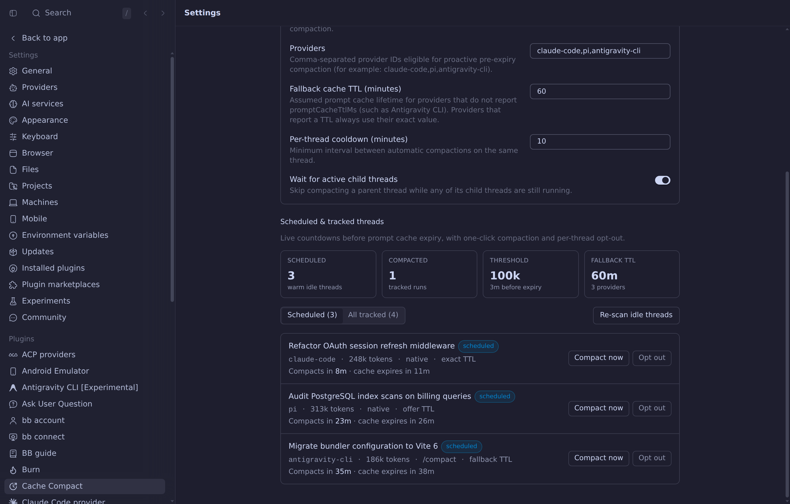
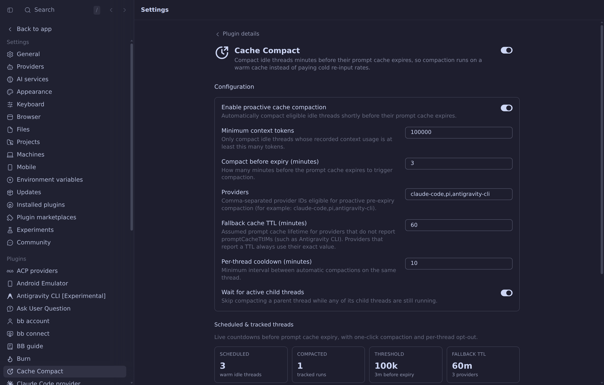

# bb-plugin-cache-compact

Compact idle [BB](https://getbb.app) threads minutes before their prompt cache expires, keeping compaction on a warm cache instead of paying cold re-input rates when you return.



## Features

- **Exact provider TTL support** — reads `promptCacheTtlMs` from `thread/tokenUsage/updated` events (and `compactionOfferAt` when BB's `compactExpiredCache` experiment is enabled) for **Claude Code** (`claude-code`) and **Pi** (`pi`), invoking native `threads.compact()`.
- **Antigravity CLI support** — supports `antigravity-cli` in the same plugin using a configurable `fallbackTtlMinutes` and its advertised `/compact` slash command, sealing the compaction turn in SQLite so it never loops.
- **Cold-cache protection** — if a thread's prompt cache has already expired (for example after your machine slept), Cache Compact skips it rather than burning uncached input tokens.
- **Safety guards** — enforces a minimum token count (`100,000`), per-thread cooldown (`10m`), per-thread opt-out, and skips threads that are active, archived, have queued work, pending interactions, or active child threads.
- **Live Settings UI & CLI** — view countdowns, trigger compaction, or opt out threads from **Settings → Cache Compact** or with `bb cache-compact`.

## Install

```sh
bb plugin install git:https://github.com/AdzeB/bb-plugin-cache-compact.git@^0.1.0
```

## Settings

Configure in **Settings → Installed plugins → Cache Compact** or via CLI (`bb plugin config cache-compact set <key> <value>`):



| Setting | Default | Description |
| --- | --- | --- |
| `enabled` | `true` | Turn proactive pre-expiry compaction on or off |
| `minTokens` | `100000` | Minimum recorded context tokens required before scheduling |
| `leadMinutes` | `3` | Minutes before cache expiry to trigger compaction |
| `providers` | `claude-code,pi,antigravity-cli` | Comma-separated eligible provider IDs |
| `fallbackTtlMinutes` | `60` | Assumed cache TTL for providers that do not emit `promptCacheTtlMs` |
| `cooldownMinutes` | `10` | Minimum minutes between automatic compactions on one thread |
| `skipWithActiveChildren` | `true` | Skip parent threads while any child thread is still running |

> **Tip:** BB releases idle provider processes after `idleProviderSessionTimeoutMinutes` (default `30`). For 1-hour caches, setting `bb settings general idleProviderSessionTimeoutMinutes 60` avoids restarting the local provider process right before compaction runs.

## CLI

```sh
bb cache-compact status [--json]
bb cache-compact check [thread-id] [--json]
bb cache-compact now [thread-id] [--force] [--json]
bb cache-compact opt-out [thread-id] [--json]
bb cache-compact opt-in [thread-id] [--json]
bb cache-compact reconcile [--json]
```

## Development

```sh
npm install
npm run check
npm test
bb plugin build .
```

## License

MIT — see [LICENSE](./LICENSE).
